<div align="center">

<h1>
  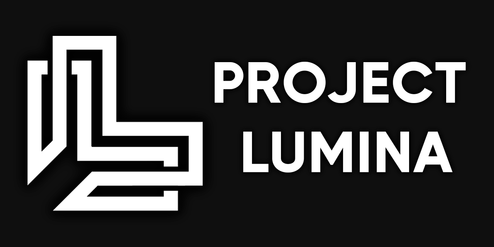
</h1>

**Swap a game's Steam API DLLs for an emulator without doing it by hand.**<br>
Backups, verification, history and batch mode included, so it doesn't turn into a mess.


[Download](../../releases/latest) · [What it does](#what-it-does) · [Screenshots](#screenshots) · [Good to know](#good-to-know) · [Building](#building)

<br>

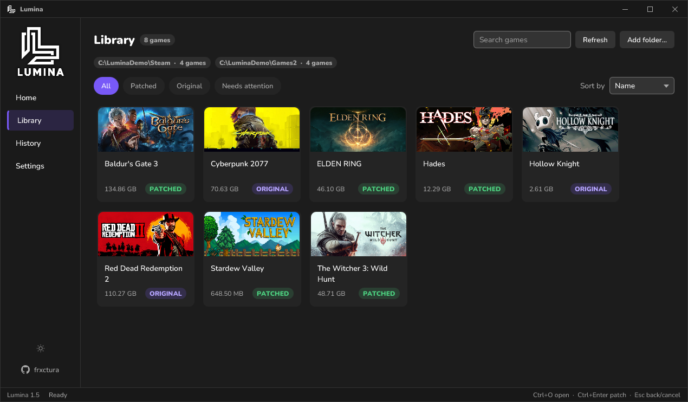

</div>

<br>

Lumina is a Windows app that replaces the Steam API DLLs in a game folder with a Steam emulator (Goldberg, gbe_fork or SmokeAPI), so the game runs without the Steam client open, or, with SmokeAPI, unlocks DLC on a game you own. You can do that by hand, it's just tedious. You need the right DLLs, a backup of the originals, a memory of what you changed, and a way to undo it all when something breaks. Lumina handles that for you and keeps track of it.

Point it at a game folder, or pick a game from your Steam library, and hit start. It backs up the originals as `.bak` files, writes the emulator's DLLs over them, then reads them back to make sure they actually match. If anything goes wrong halfway, everything goes back how it was, so you never end up with a half-patched game.

## Getting started

1. Grab `LuminaSetup-1.4.exe` from the [latest release](../../releases/latest) and run it.
2. Open Lumina and pick a game.
3. Hit start. The first time, it downloads the emulator itself, so there's nothing to set up.

Prefer building it yourself? Skip to [Building](#building).

## What it does

| | |
|---|---|
| **Steam library** | Finds your libraries and shows every game with cover art, size, and a badge for original, patched or mixed. It works that out by hashing the DLLs, so it even spots games you patched by hand. |
| **Batch mode** | Tick a few games and patch them in one run. A game that's currently running gets pushed to the end of the queue and patched once you close it. |
| **Backups** | Keeps the original DLLs as `.bak` files, and can copy the whole game folder first if you want a clean copy to go back to. |
| **Verify and rollback** | Every patched file is read back and checked. If one fails, everything is undone. |
| **Three emulators** | Goldberg, gbe_fork and SmokeAPI, picked per game, with per-game settings like username, Steam ID, language, offline mode and a DLC list pulled from Steam. |
| **SteamStub unpacking** | Optional. Some games wrap their `.exe` in Steam's SteamStub DRM, and Lumina can remove it with [Steamless](https://github.com/atom0s/Steamless). It only touches executables that actually have the wrapper, and keeps the original. |
| **History** | Every patch and restore, with where its backups are, how much space they take, and one-click open, restore and clean-up. |
| **Safety checks** | Warns you if the game is running, checks you have the disk space first, and notices when antivirus eats a DLL. |
| **Themes** | Dark, light, or follow Windows. |

## Screenshots

<table>
  <tr>
    <td width="50%">
      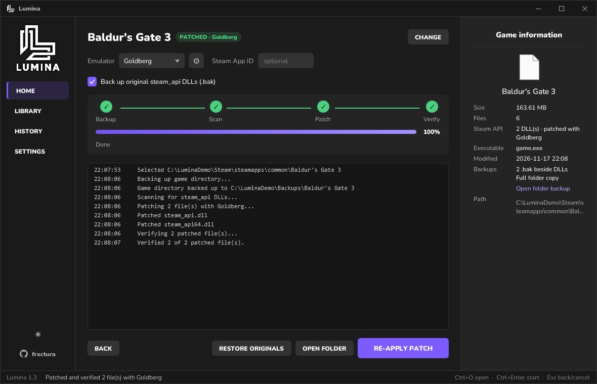
      <br><b>Home</b><br>A step tracker and a live log while it works.
    </td>
    <td width="50%">
      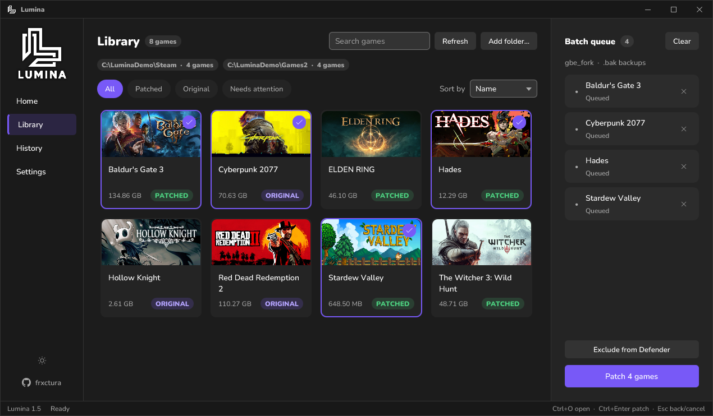
      <br><b>Library and batch queue</b><br>Tick games, hit the button, go make tea.
    </td>
  </tr>
  <tr>
    <td>
      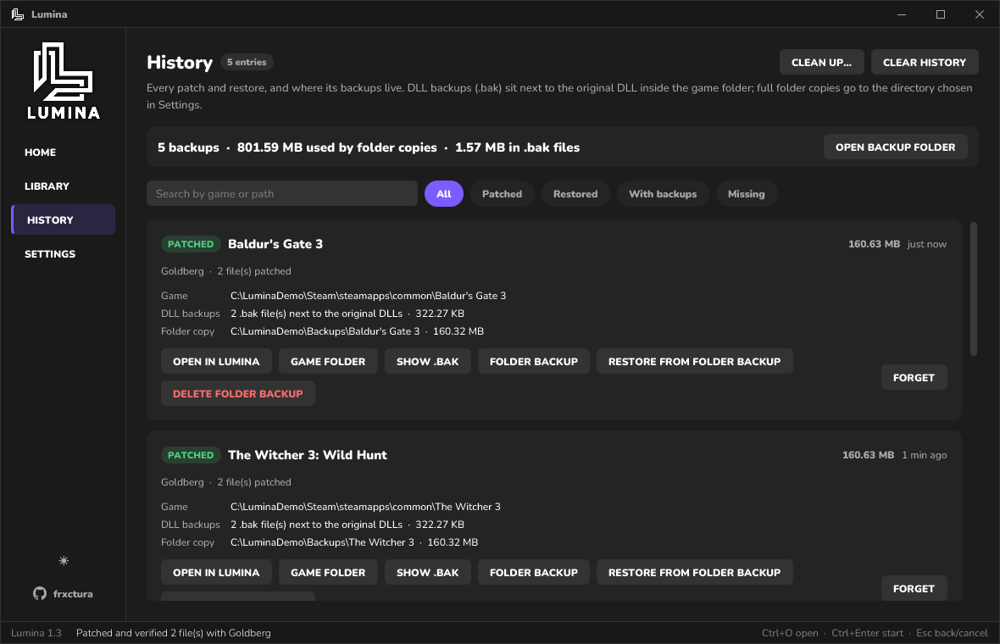
      <br><b>History</b><br>What you patched, where the backups went, and how to undo it.
    </td>
    <td>
      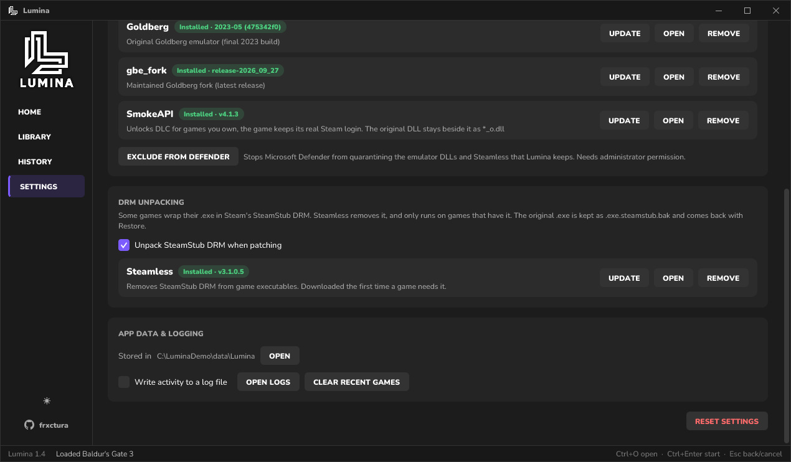
      <br><b>Settings</b><br>Themes, backup options and the emulators.
    </td>
  </tr>
</table>

Before it touches anything, it shows you what it's about to do:

<p align="center">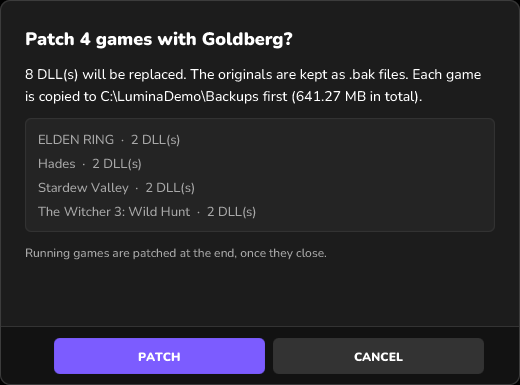</p>

And it looks fine in light mode too:

<p align="center">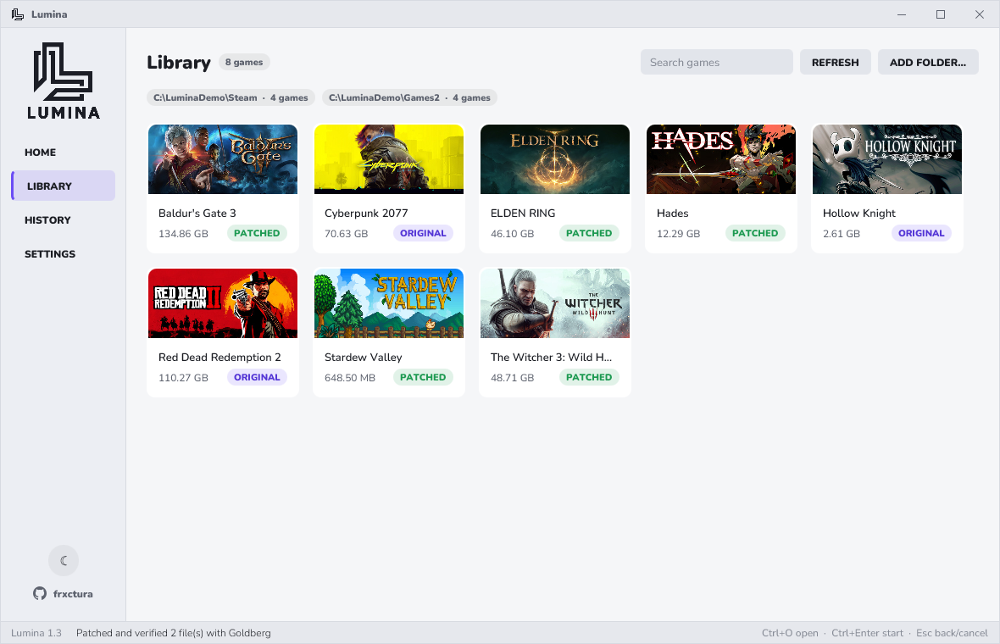</p>

### In action

<table>
  <tr>
    <td width="50%">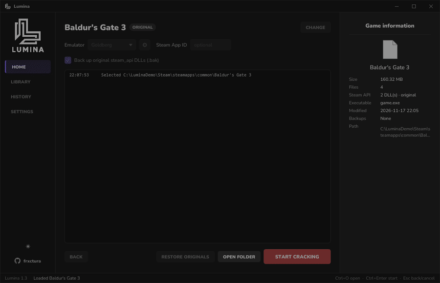<br><b>One game</b><br>Back up, scan, patch, verify.</td>
    <td width="50%">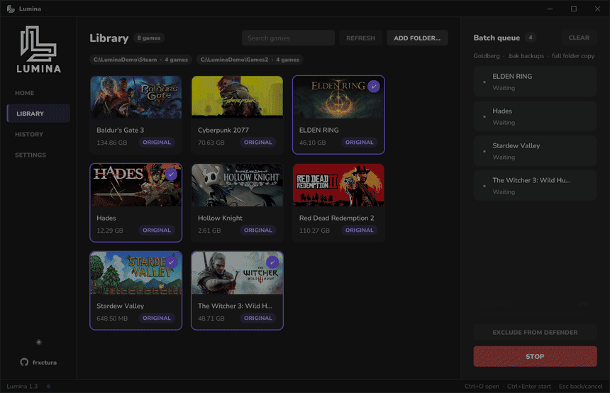<br><b>Batch</b><br>Four games from the Library in one go.</td>
  </tr>
</table>

## Using it

You can open a game by dropping its folder on the window, browsing to it (Ctrl+O), or dropping the folder onto `Lumina.exe`. If Steam is installed, the Library page lists everything you've got. To patch a pile of games at once, tick them in the Library and hit the button at the bottom right.

Everything you patch or restore lands in History. From there you can open the game or backup folder, restore the original DLLs, or delete old backups.

## Emulators

Goldberg is the original, and its last release was in 2023. gbe_fork is the maintained fork. You can download, update or remove either one in Settings and pick which to use per game.

SmokeAPI works differently from the other two. It doesn't pretend to be Steam, it only makes the game think you own its DLC, so you keep your real Steam login. Instead of overwriting the DLL it takes its place and loads the original, which stays next to it as `steam_api64_o.dll`. That file has to be there for the game to start, so Lumina always keeps it, whatever the `.bak` option says, and Restore puts it back.

Each game also gets its own emulator settings: username, Steam ID, language, offline mode, and a DLC list that Lumina can pull from Steam for you. They're written in whatever format the emulator you picked expects. For SmokeAPI that's just "unlock every DLC" plus any extra DLC Steam doesn't list, in `SmokeAPI.config.json`.

### SteamStub unpacking

Some games wrap their `.exe` in Steam's SteamStub DRM, and swapping the DLLs isn't enough for those. Tick "Unpack SteamStub DRM" on the Home page (or in Settings) and Lumina runs Steamless on the executables that have it. The Home page also tells you how many executables in the game carry the wrapper. It spots them by reading the exe's section table, so nothing gets run on a game that doesn't need it, and Steamless itself is only downloaded the first time one does. The original is kept as `game.exe.steamstub.bak` and Restore brings it back. Steamless can't handle every SteamStub version: if it fails on one, that exe is left exactly as it was, you get told, and the DLLs are still patched.

## Good to know

> [!WARNING]
> Antivirus will probably try to eat the emulator DLLs, Defender especially, and no, that's not Lumina's fault lol. If a DLL vanishes or changes right after Lumina writes it, you get told instead of being shown a fake success.

gbe_fork and Steamless get hit the hardest, so when you patch with either Lumina offers to add a Defender exclusion for the game folder (where the DLLs end up) and its own emulator and tools folders before it starts. It asks once per game, and Windows asks for admin. You can also do it yourself any time: tick games in the Library and hit "Exclude from Defender" in the queue panel, which works with either emulator.

<p align="center">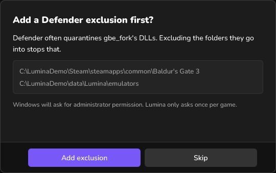</p>

Lumina only touches the `steam_api` DLLs in the folder you give it, plus the game's `.exe` if you turned on SteamStub unpacking and it has the wrapper. It searches the whole folder tree, so a game with a few copies gets all of them patched, and the rest of the game is left alone. The emulator's own files go in a `steam_settings` folder next to each DLL (or a `SmokeAPI.config.json` for SmokeAPI).

> [!NOTE]
> Use it on games you own, obviously.

## How it's made

I build Lumina alongside AI tools, mostly Claude Code, and I'd rather say so up front than have you wonder. It's not a pile of generated code that nobody looked at, though. I test it, I make sure it works properly and looks good, and the file handling, patch detection and rollback code have real tests (`gradlew test`). If it doesn't work, it doesn't go out.

If you see "AI" and write something off as slop on the spot, Lumina probably isn't for you, and that's fine. If you just want something that does the job without breaking your games, give it a go :)

## Building

You need JDK 17 or newer, and Windows.

```
gradlew run          start from source
gradlew test         run the tests
gradlew installer    build build/installer/LuminaSetup-<version>.exe
```

The installer task needs [Inno Setup](https://jrsoftware.org/isinfo.php). `scoop install inno-setup` is the easiest way to get it. Lumina keeps its data in `%LOCALAPPDATA%\Lumina`: the downloaded emulators, your history, and a log file if you turn that on.

## Problems

If something breaks, open an issue. Turn on "Log to file" in Settings first and attach what it writes, plus which game and which emulator you used, otherwise I'm just guessing.

## Roadmap

The only thing left on the list is generating `steam_interfaces.txt` automatically for older games that need it. Everything else I wanted is already in: game info and covers, moving the game folder after patching, full-folder backups, switching emulators, and the per-game settings editor.

<details>
<summary><b>Project layout</b></summary>

<br>

```
src/main/java/com/javafxapp/javafxapp/
  patching/     patch, restore and batch jobs, patch detection
  emulator/     downloading Goldberg, gbe_fork and SmokeAPI, per-game settings
  unpack/       SteamStub detection and the Steamless tool
  backup/       history, backup sizes, folder restore
  library/      Steam library scan, game info, cover cache
  safety/       running-game check, disk space, Defender exclusion
  config/       settings and app data paths
  common/       background jobs, progress, file copying, HTTP, logging
  ui/           window shell, pages, components, dialogs
src/main/resources/   FXML views, stylesheets, images, fonts
installer/            Inno Setup script
```

</details>
